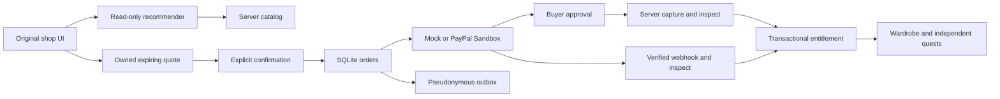

# Game Commerce Agent

A goal-solving game agent: player intent and state → use owned items, borrow freely, decline purchase, or select a real server SKU → explicit purchase confirmation → PayPal **Sandbox** approval → verified payment → durable outfit entitlement.

This repository contains an original, playable **Rosalyn’s Atelier** courtyard, shop and guard scene, reusable commerce modules, and a browser UI. It does not contain private game code, art, or the development brief. No existing game or service is modified.

## Run locally

Requires **Node.js 24+** (built-in SQLite). Runtime has no third-party dependencies.

```sh
npm ci
cp .env.example .env
npm test
npm start
# Open http://localhost:3000
```

Default `PAYMENT_PROVIDER=mock` and `AI_PROVIDER=mock` are entirely offline. “Simulate buyer approval + verified webhook” is explicitly a simulation. No credentials, payment, external AI, or account creation is needed. The deterministic mock recommender is **not a real LLM**.

1. Enter a goal such as “I want to go to the gathering.” (The mock also recognizes “무도회에 가고 싶어”.)
2. Choose **Borrow for free** or **Find a look to buy**. A suitable owned outfit replaces borrowing with **Wear what I own**.
3. Preview first. No ownership, equipment or quest flag changes until an explicit confirmation. The paid preview names the exact product, USD amount and currency.
4. Confirm the free loan/owned outfit, or confirm the optional purchase and use **Complete mock payment**. Choose Wear after a completed purchase.
5. In the courtyard, collect the free seal and password, then enter. Payment never skips these quests.
6. Reload in the same unexpired session to restore wardrobe and quest progress. Movement and typed goals are not saved.

Only one main stage is visible at a time. Budget, full comparison, authored NPC explanations, wardrobe details and evidence are collapsed until requested. The short preview shows current ownership, cost and remaining conditions. [English draft](docs/submission-draft.md) · [2:45 rehearsal](docs/demo-script.md).

The server listens on loopback only. This is an isolated Sandbox prototype, not a deployed shop. The anonymous, server-issued HttpOnly cookie represents a demo player. The same unexpired cookie restores server state after reload/restart; this is not account login or cross-device recovery. The implemented `AuthenticatedPrincipalAdapter` instead consumes a host-verified stable principal on every request and restores rights across host re-logins. It does not verify tokens itself or connect to a private authentication DB. Production startup rejects anonymous mode. See [the contracts](docs/contracts.md).

## Offline Sandbox setup helper

Download [paypal-oauth-helper.html](tools/paypal-oauth-helper.html) and open the saved file locally. This single Korean HTML file lets the user paste their Sandbox Client ID and Secret into masked fields, generate the full Basic Authorization value, explicitly copy it, and clear the page. It needs no server, external resources or provider calls. The agent never handles real credentials. See [usage, validation policy and test limits](docs/offline-helper.md).

## Verification

```sh
npm run check          # Syntax checks and unit/HTTP/adapter tests; no external API calls
npm run format:check
npm run test:browser   # Installed Chromium required; actual UI interactions, offline mock
npm run test:helper    # Offline OAuth helper: fake inputs, keyboard/mobile/CSP checks
node scripts/evaluate-ai.js # Zero-network cost/evaluation preflight; --live requires prepared configuration
npm run funnel        # Local operator aggregate; no raw dialogues or payment data
```

`CHROMIUM=/path/to/chromium` and `BROWSER_TEST_PORT=3137` customize the browser test. It uses a temporary profile and in-memory ledger. Its screenshot is written to `/tmp/gca-browser-smoke.png`, not committed. The browser uses `--no-sandbox` for this isolated container smoke test; do not use that flag for normal browsing.

The AI interpretation contract has independent fixed gold goals, constraints, products and required/allowed actions: 12 regression sentences × 3 states = 36 cases, plus 8 wording holdouts absent from prompt examples. The [versioned evaluation contract](docs/ai-evaluation.md) fixes unsupported/attack/ambiguity policy, narrowly permits neutral story-only style equivalence, and gates the 44 cases behind one compatibility smoke. Timestamped JSONL traces record commit, prompt/gold hashes, sanitized plans, typed errors, latency and usage; reserved budget, token-derived estimate and unknown billed amount stay distinct. All 44 are stub contract tests; actual model accuracy is unmeasured. The separate 36-case offline parser suite is not a model benchmark.

Tests cover explicit confirmation, quote expiry, unknown SKU, owner/amount/currency mismatch, approval required, duplicate and out-of-order callbacks, concurrent requests, timeout recovery, cancellation, terminal failure, realistic refund-ID correlation, capture-operation races, merchant mismatch, mode isolation, refund holds, durable restart, capture uniqueness, session isolation, CSRF, prompt-injected/hallucinated SKUs, the free route, and outbox retries. PayPal transport tests use stubbed responses; passing them does **not** establish Sandbox E2E success.

## Real Sandbox and real AI

See [Sandbox runbook](docs/sandbox-runbook.md). Real calls require separately configured, approved credentials:

| Variable                                   | Purpose                                                                                     |
| ------------------------------------------ | ------------------------------------------------------------------------------------------- |
| `PAYMENT_PROVIDER=paypal-sandbox`          | Explicit real Sandbox adapter selection                                                     |
| `PAYPAL_CLIENT_ID`, `PAYPAL_CLIENT_SECRET` | Existing Sandbox application credentials, server only                                       |
| `PAYPAL_OAUTH_BASIC_AUTH_HEADER`           | Alternative full Authorization header placeholder; mutually exclusive with client ID/secret |
| `PAYPAL_WEBHOOK_ID`                        | Existing Sandbox webhook registration for this application                                  |
| `PAYPAL_MERCHANT_ID`                       | Expected Sandbox seller merchant ID; required payee validation                              |
| `PAYPAL_BASE_URL`                          | Must equal `https://api-m.sandbox.paypal.com`; live/alternate URLs are always rejected      |
| `PUBLIC_ORIGIN`                            | Exact browser origin and PayPal return origin                                               |
| `AI_PROVIDER=openai`                       | Explicit real AI selection; can incur API costs                                             |
| `OPENAI_API_KEY`, `OPENAI_MODEL`           | Approved key; cost guard currently pins `gpt-4.1-mini-2025-04-14` (availability untested)   |
| `DATABASE_PATH`                            | Persistent SQLite location; default `./data/commerce.sqlite`                                |

Real AI additionally requires `AUTH_MODE=principal` with an injected host verifier (or the explicit independent Sandbox host below), `AI_ACCESS_ENABLED=true` and a positive `AI_TOTAL_CALL_LIMIT`. Defaults deny real AI access. AI attempts persist across sessions/restarts. A second, shared $5 reservation guard limits real AI transport to 100 attempts at $0.05 reserved each, one concurrent request through body parsing/cancellation, a pinned model and bounded input/output. Webhook verification uses a separate durable 60-second window (default 100 attempts, two concurrent requests). Exhaustion returns 429 without skipping signature verification; the next window permits retry. SQLite reservations also enforce these caps across workers sharing the same local database. See operator recovery and support limits in the runbook.

For the independent original scene, `src/sandbox-demo.js` supplies a separate authenticated test host and server-owned NPC dialogue/quest adapter. It requires explicit enablement and operator-provided existing test access; it does not issue anonymous principals or connect to private game authentication. Production startup rejects this demo host. Its database is bound to its host identity as well as payment provider. See [the demo host setup contract](docs/sandbox-runbook.md#independent-sandbox-demo-host). No access credentials are configured by the repository.

No credentials were created or configured during initial implementation. Real PayPal Sandbox E2E, signed provider webhook delivery and real AI execution remain **unverified**. The app never silently falls back from a misconfigured real provider to mock. `NODE_ENV` cannot enable live payments.

In real AI mode, the goal text, server catalog descriptions and minimal game context are sent to the configured AI provider. Goal text is not persisted in the ledger, analytics or outbox. The model interprets story versus collection goals, style exclusions, free preference and ambiguity through a strict read-only intent schema. A separate pure server planner validates that interpretation against current rights, quests and budget and supplies canonical products and allowed actions. The planner simulates resulting equipment and missing quests: collecting a cloak must not undo formal entry, and wearing an owned Gala needs no redundant loan. Interpretation cannot change prices, rights or quest state. The offline parser is limited rehearsal behavior, not measured AI quality. There are no payment tools available to the model.

## Architecture and trust



- `src/commerce.js`: state transitions and atomic grant/receipt/event writes. Prices are integer minor units. Owner comes from the authenticated server session; `userId` query/body identity is rejected.
- `src/store.js`: SQLite WAL, uniqueness constraints, quotes, order/capture ledger, entitlements, mock provider state, sessions, quest state and analytics outbox.
- `src/providers/`: interchangeable provider implementations. PayPal uses fixed Sandbox OAuth, Orders v2, stable request IDs, server reads and signature verification API.
- `src/recommend.js`: bounded, read-only catalog selection with a separate offline mock mode.
- `src/game.js`, `src/contracts.d.ts`: independent fixture and public host integration contracts.
- `src/outbox.js`: at-least-once delivery to a trusted, deduplicating sink; no mimi-seed-sdk dependency or copied code.

Order states: `CREATING → APPROVAL_PENDING → CAPTURE_PENDING → AWAITING_WEBHOOK → GRANTED`. A verified completion webhook may recover a remotely completed capture directly. `CANCELLED`, `FAILED` and `REVIEW` represent non-grant paths. A lost create response remains `CREATING`; reload restores its original confirmed quote and offers explicit resume with the same order/idempotency key, even after quote expiry, within the five-hour retry boundary. Cancellation cannot be undone by a late create response. A timeout remains recoverable; only explicit provider decline codes become terminal. Local cancellation prevents this application from initiating a capture; it does not revoke an already-created remote approval URL. Late captures after cancellation go to review. Verified early refund/reversal references are retained in a durable inbox; refunds use their original capture link plus fixed-API revalidation. Refund/reversal puts existing rights on hold and prevents late completion from restoring them.

A database provider marker rejects reopening mock data as Sandbox data. A five-minute capture operation lease and atomic compare-and-swap state changes prevent delayed reads from enabling cancellation during another capture. State is checked again after every provider await.

One entitlement per `(user, SKU)`, one order per quote, one local owner per provider order/capture, and webhook receipt uniqueness prevent repeated grants. Grant and outbox event commit together. External payment effects are reconciled, not made magically atomic with SQLite.

## Scope and next steps

- The original scene is playable; [private-game integration](docs/private-integration-proposal.md) remains a separate, unexecuted proposal. Preserve its seal, outfit and rumor predicates.
- OneSub’s MIT entitlement evaluator is now actually reused by `src/entitlements.js`, after filtering out unverified, held or wrong-owner ledger records. The pinned extracted core, types, copyright and license are in `src/vendor/onesub`; [notices](THIRD_PARTY_NOTICES.md) identify the exact source. 324 differential cases match the pinned upstream evaluator. No Apple/Google platform impersonation or mobile SDK is involved.
- mimi-seed-sdk code is not copied. A trusted external adapter can consume the documented outbox contract and [example aggregate queries](docs/analytics.sql).
- Missing webhooks keep payments pending. There is no autonomous scheduler, refund issuance, chargeback-dispute workflow, built-in identity provider, multi-instance deployment, automatic outbox exporter or production support. See reconciliation and review steps in the runbook.
- No deployment, hackathon signup, terms acceptance, submission or video recording has been performed. [Demo script](docs/demo-script.md) is prepared for a future English video under three minutes. Real Sandbox + AI demonstration is still required before claiming submission readiness.

## License and references

MIT; see [LICENSE](LICENSE). Artwork is original CSS/HTML. Third-party development tooling retains its package license; no third-party game assets are bundled.

- [PayPal Orders v2](https://developer.paypal.com/api/orders/v2)
- [PayPal Payments v2 (capture/refund lookup)](https://developer.paypal.com/api/payments/v2)
- [PayPal webhook verification](https://developer.paypal.com/api/webhooks/v1)
- [OpenAI Chat Completions](https://developers.openai.com/api/reference/resources/chat)
- [OneSub entitlement evaluator](https://github.com/jeonghwanko/onesub/blob/master/packages/server/src/routes/entitlements.ts)
- [Hackathon rules](https://paypalaihackathon.devpost.com/rules): current deadline November 12, 2026, 12:00 PST (November 13, 05:00 KST). Review the official rules again before submitting.

See [verification evidence and remaining gaps](docs/evidence-and-gaps.md) for what is measured locally and what still requires approved live Sandbox/AI access.
