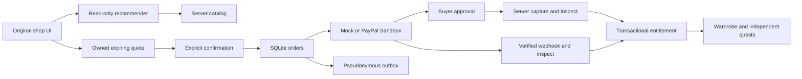

# Game Commerce Agent

A goal-solving game agent: player intent and state → use owned items, borrow freely, decline purchase, or select a real server SKU → explicit purchase confirmation → PayPal **Sandbox** approval → verified payment → durable outfit entitlement.

This repository contains an original, playable **Rosalyn’s Atelier** courtyard, shop and guard scene, reusable commerce modules, and a browser UI. It does not contain private game code, art, or the development brief. No existing game or service is modified.

## Run locally

Requires **Node.js 24+** (built-in SQLite). Runtime has no third-party dependencies.

```sh
npm ci
cp .env.example .env
npm test
npm start
# Open http://localhost:3000
```

Default `PAYMENT_PROVIDER=mock` and `AI_PROVIDER=mock` are entirely offline. “Simulate buyer approval + verified webhook” is explicitly a simulation. No credentials, payment, external AI, or account creation is needed. The deterministic mock recommender is **not a real LLM**.

1. Click the courtyard or use WASD / arrow keys to approach the shop; press E to talk. Accessible “Walk to…” controls move the same character.
2. Ask for a goal with a USD budget. The server plan distinguishes owned clothes, free borrowing, no purchase and a suitable optional purchase.
3. Preview the violet coat with gold embroidery or teal cloak. Review the exact server quote and explicitly confirm it.
4. Simulate buyer approval and verified webhook in mock mode. Equip the outfit and see the character change.
5. Talk to the courier for the seal and the archivist for the rumor. The gatekeeper requires formal clothes **and** both free quests.
6. Walk through the open gate. A new player can finish by borrowing the plain formal outfit without creating any order. The optional evidence panel is collapsed during play.

The server listens on loopback only. This is an isolated Sandbox prototype, not a deployed shop. The anonymous, server-issued HttpOnly cookie represents a demo player. The same unexpired cookie restores server state after reload/restart; this is not account login or cross-device recovery. The implemented `AuthenticatedPrincipalAdapter` instead consumes a host-verified stable principal on every request and restores rights across host re-logins. It does not verify tokens itself or connect to a private authentication DB. Production startup rejects anonymous mode. See [the contracts](docs/contracts.md).

## Verification

```sh
npm run check          # Syntax checks and unit/HTTP/adapter tests; no external API calls
npm run format:check
npm run test:browser   # Installed Chromium required; actual UI interactions, offline mock
npm run funnel        # Local operator aggregate; no raw dialogues or payment data
```

`CHROMIUM=/path/to/chromium` and `BROWSER_TEST_PORT=3137` customize the browser test. It uses a temporary profile and in-memory ledger. Its screenshot is written to `/tmp/gca-browser-smoke.png`, not committed. The browser uses `--no-sandbox` for this isolated container smoke test; do not use that flag for normal browsing.

Tests cover explicit confirmation, quote expiry, unknown SKU, owner/amount/currency mismatch, approval required, duplicate and out-of-order callbacks, concurrent requests, timeout recovery, cancellation, terminal failure, realistic refund-ID correlation, capture-operation races, merchant mismatch, mode isolation, refund holds, durable restart, capture uniqueness, session isolation, CSRF, prompt-injected/hallucinated SKUs, the free route, and outbox retries. PayPal transport tests use stubbed responses; passing them does **not** establish Sandbox E2E success.

## Real Sandbox and real AI

See [Sandbox runbook](docs/sandbox-runbook.md). Real calls require separately configured, approved credentials:

| Variable                                   | Purpose                                                                                |
| ------------------------------------------ | -------------------------------------------------------------------------------------- |
| `PAYMENT_PROVIDER=paypal-sandbox`          | Explicit real Sandbox adapter selection                                                |
| `PAYPAL_CLIENT_ID`, `PAYPAL_CLIENT_SECRET` | Existing Sandbox application credentials, server only                                  |
| `PAYPAL_WEBHOOK_ID`                        | Existing Sandbox webhook registration for this application                             |
| `PAYPAL_MERCHANT_ID`                       | Expected Sandbox seller merchant ID; required payee validation                         |
| `PAYPAL_BASE_URL`                          | Must equal `https://api-m.sandbox.paypal.com`; live/alternate URLs are always rejected |
| `PUBLIC_ORIGIN`                            | Exact browser origin and PayPal return origin                                          |
| `AI_PROVIDER=openai`                       | Explicit real AI selection; can incur API costs                                        |
| `OPENAI_API_KEY`, `OPENAI_MODEL`           | Approved key and model supporting strict Chat Completions JSON Schema output           |
| `DATABASE_PATH`                            | Persistent SQLite location; default `./data/commerce.sqlite`                           |

Real AI additionally requires `AUTH_MODE=principal` with an injected host verifier, `AI_ACCESS_ENABLED=true` and a positive `AI_TOTAL_CALL_LIMIT`. Defaults deny real AI access. Total attempts persist across sessions/restarts; concurrency is capped at two. Webhook verification has a separate persistent `WEBHOOK_TOTAL_VERIFY_LIMIT` (default 100) and concurrency cap. Exhaustion fails closed; limits are not an automatic billing authorization.

No credentials were created or configured during initial implementation. Real PayPal Sandbox E2E, signed provider webhook delivery and real AI execution remain **unverified**. The app never silently falls back from a misconfigured real provider to mock. `NODE_ENV` cannot enable live payments.

In real AI mode, the goal text, filtered server catalog and minimal game context are sent to the configured AI provider. Goal text is not persisted in the ledger, analytics or outbox. A server-owned goal planner chooses safe actions; the model only chooses eligible SKU strings using strict schema and no tools; the server validates every result and supplies the displayed names, prices, descriptions and gameplay effects. There are no payment tools available to the model.

## Architecture and trust



- `src/commerce.js`: state transitions and atomic grant/receipt/event writes. Prices are integer minor units. Owner comes from the authenticated server session; `userId` query/body identity is rejected.
- `src/store.js`: SQLite WAL, uniqueness constraints, quotes, order/capture ledger, entitlements, mock provider state, sessions, quest state and analytics outbox.
- `src/providers/`: interchangeable provider implementations. PayPal uses fixed Sandbox OAuth, Orders v2, stable request IDs, server reads and signature verification API.
- `src/recommend.js`: bounded, read-only catalog selection with a separate offline mock mode.
- `src/game.js`, `src/contracts.d.ts`: independent fixture and public host integration contracts.
- `src/outbox.js`: at-least-once delivery to a trusted, deduplicating sink; no mimi-seed-sdk dependency or copied code.

Order states: `CREATING → APPROVAL_PENDING → CAPTURE_PENDING → AWAITING_WEBHOOK → GRANTED`. A verified completion webhook may recover a remotely completed capture directly. `CANCELLED`, `FAILED` and `REVIEW` represent non-grant paths. A timeout remains recoverable; only explicit provider decline codes become terminal. Local cancellation prevents this application from initiating a capture; it does not revoke an already-created remote approval URL. Late captures after cancellation go to review. Verified early refund/reversal references are retained in a durable inbox; refunds use their original capture link plus fixed-API revalidation. Refund/reversal puts existing rights on hold and prevents late completion from restoring them.

A database provider marker rejects reopening mock data as Sandbox data. A five-minute capture operation lease and atomic compare-and-swap state changes prevent delayed reads from enabling cancellation during another capture. State is checked again after every provider await.

One entitlement per `(user, SKU)`, one order per quote, one local owner per provider order/capture, and webhook receipt uniqueness prevent repeated grants. Grant and outbox event commit together. External payment effects are reconciled, not made magically atomic with SQLite.

## Scope and next steps

- The original scene is playable; [private-game integration](docs/private-integration-proposal.md) remains a separate, unexecuted proposal. Preserve its seal, outfit and rumor predicates.
- OneSub’s MIT entitlement evaluator is now actually reused by `src/entitlements.js`, after filtering out unverified, held or wrong-owner ledger records. The pinned extracted core, types, copyright and license are in `src/vendor/onesub`; [notices](THIRD_PARTY_NOTICES.md) identify the exact source. 324 differential cases match the pinned upstream evaluator. No Apple/Google platform impersonation or mobile SDK is involved.
- mimi-seed-sdk code is not copied. A trusted external adapter can consume the documented outbox contract and [example aggregate queries](docs/analytics.sql).
- Missing webhooks keep payments pending. There is no autonomous scheduler, refund issuance, chargeback-dispute workflow, built-in identity provider, multi-instance deployment, automatic outbox exporter or production support. See reconciliation and review steps in the runbook.
- No deployment, hackathon signup, terms acceptance, submission or video recording has been performed. [Demo script](docs/demo-script.md) is prepared for a future English video under three minutes. Real Sandbox + AI demonstration is still required before claiming submission readiness.

## License and references

MIT; see [LICENSE](LICENSE). Artwork is original CSS/HTML. Third-party development tooling retains its package license; no third-party game assets are bundled.

- [PayPal Orders v2](https://developer.paypal.com/api/orders/v2)
- [PayPal Payments v2 (capture/refund lookup)](https://developer.paypal.com/api/payments/v2)
- [PayPal webhook verification](https://developer.paypal.com/api/webhooks/v1)
- [OpenAI Chat Completions](https://developers.openai.com/api/reference/resources/chat)
- [OneSub entitlement evaluator](https://github.com/jeonghwanko/onesub/blob/master/packages/server/src/routes/entitlements.ts)
- [Hackathon rules](https://paypalaihackathon.devpost.com/rules): current deadline November 12, 2026, 12:00 PST (November 13, 05:00 KST). Review the official rules again before submitting.

See [verification evidence and remaining gaps](docs/evidence-and-gaps.md) for what is measured locally and what still requires approved live Sandbox/AI access.
